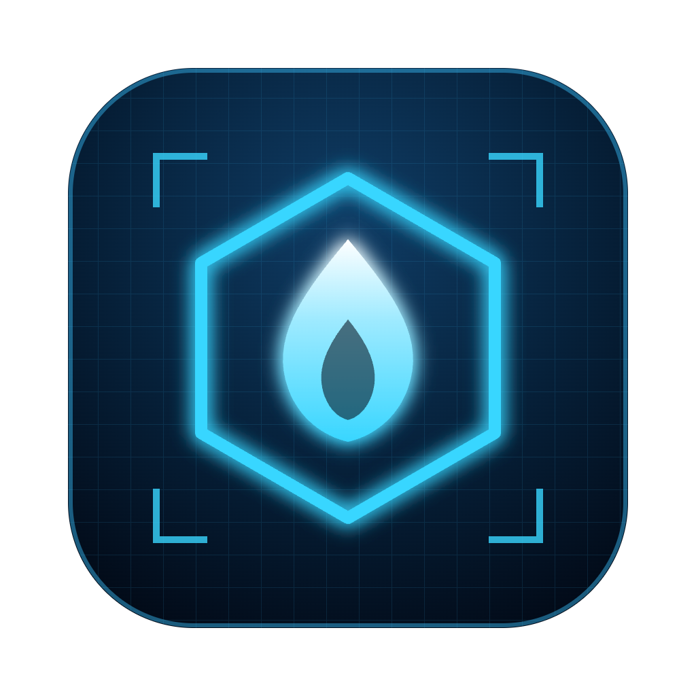
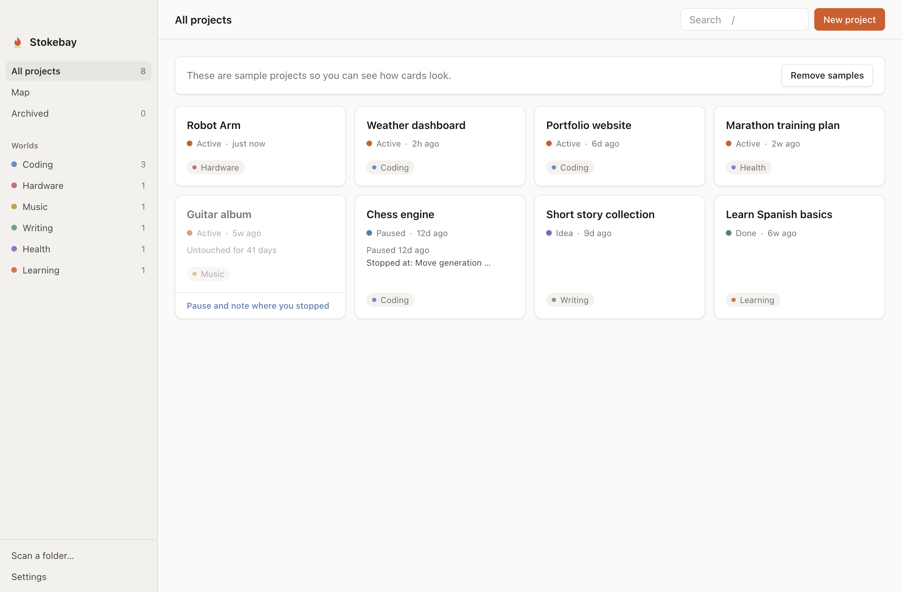
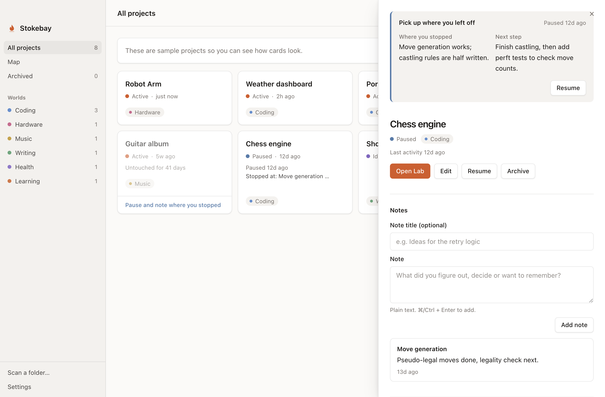
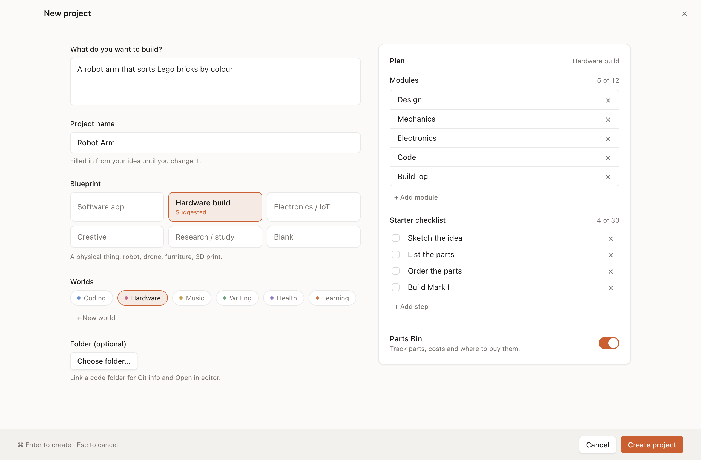
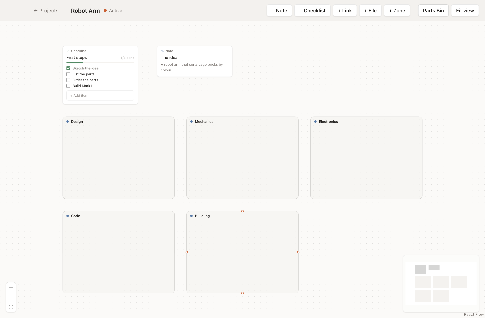
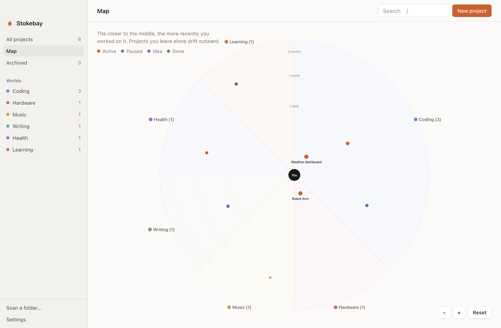
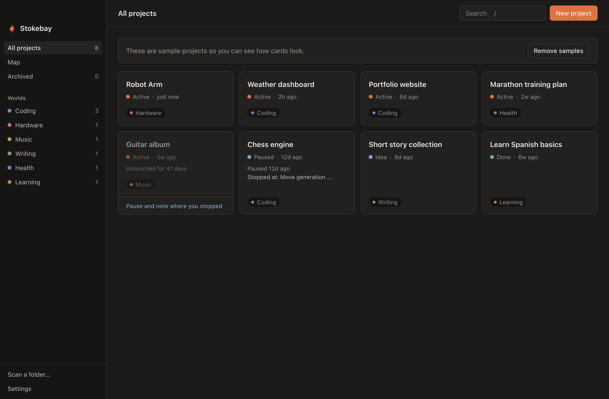

<p align="center">
  
</p>

<h1 align="center">Stokebay</h1>

<p align="center">
  One calm place for every project you care about, and a way back in when you return to one.
</p>

<p align="center">
  
</p>

Most of us have more projects than we can keep in our heads: an app half-built, a guitar
album, a robot arm waiting on parts, a course we meant to finish. Stokebay keeps them in one
place, notices which ones have gone quiet, and when you open one again it tells you where you
stopped and what you meant to do next.

It runs on your computer, works offline, needs no account and is free.

## What it does

- **All your projects, any kind.** Software, hardware, music, writing, learning. Group them
  into areas you choose.
- **Pick up where you left off.** Pausing a project asks two questions: where did you stop, and
  what's next. For code projects the note is pre-filled from Git (branch, uncommitted files,
  last commit), and you can ask to be reminded in a few days. Next time, **Pick up** resumes
  it and opens your editor and a terminal in one click.
- **Quick capture from anywhere.** Press ⌘⇧Space in any app, type a thought, pick the project,
  press Enter. It's saved as a note.
- **Keeps itself up to date.** New commits appear on the project's timeline by themselves.
  Projects you haven't touched for 30 days (you choose) pause themselves, so the list shows what
  you're really working on.
- **Weekly review.** Once a week, a two-minute walk through the projects going cold: keep
  going, pause with a note, mark done, or let it go.
- **A Lab for each project.** A whiteboard for notes, checklists, links, images and files,
  arranged in zones.
- **Parts Bin.** For physical builds: what to buy, what it costs, what has arrived.
- **Map.** Every project as a dot around you: the closer to the middle, the more recently you
  worked on it.
- **Finds your code.** Searches your computer for Git projects, with the branch and last commit
  on each card, and opens them in your editor (VS Code, Cursor, Zed, Windsurf or Sublime Text).
- **A terminal built in.** Open a terminal tab right beside your projects, already in the
  project's folder, with your own shell and prompt (⌃`). Prefer Warp, iTerm or Ghostty? Pick it in
  Settings.
- **Full-text search.** Finds words inside your notes, links and Lab items, not just titles.
- **Backups you control.** A copy every day on your computer, plus an optional daily copy into
  any folder, such as Google Drive or Dropbox, with one-click restore.

|                                                             |                                                   |
| ----------------------------------------------------------- | ------------------------------------------------- |
|                  |   |
|                         |                   |

Light and dark mode follow your system.

<p align="center">
  
</p>

## Download

Get the latest version from the [Releases](https://github.com/viny4/stokebay/releases) page:

- **macOS:** the `.dmg` (`arm64` for Apple silicon, `x64` for Intel Macs)
- **Windows:** `Stokebay-… Setup.exe`
- **Linux:** the `.deb` (Ubuntu, Debian) or `.rpm` (Fedora, openSUSE)

The app isn't signed with a paid Apple or Microsoft certificate yet, so your computer asks once:

- **macOS:** open Stokebay, then go to **System Settings → Privacy & Security** and click **Open
  Anyway**.
- **Windows:** if SmartScreen says "Windows protected your PC", click **More info → Run anyway**.

## Your data

Everything stays on your computer, in one data file plus your Lab files
(`~/Library/Application Support/Stokebay` on macOS). Settings → **Show data folder** opens it.
Nothing is sent anywhere.

## Build from source

You'll need Node.js 22.13 or newer and Git. On Linux, also the usual build tools (`build-essential`,
`python3`), because the built-in terminal compiles a small native part during `npm install`.

```bash
git clone https://github.com/viny4/stokebay.git
cd stokebay
npm install
npm start          # run in development
npm run make       # build the installers for your platform into out/make
```

Checks: `npm run typecheck`, `npm run lint`, `npm test`. Releases are built by GitHub Actions;
see [docs/releasing.md](docs/releasing.md).

Built with Electron, React, TypeScript, Tailwind CSS and React Flow.

## Licence

Stokebay is free software under the [GNU Affero General Public License v3.0](LICENSE). You can
use, study, change and share it; if you share a changed version, including running it as a
service, you share your changes under the same licence.
